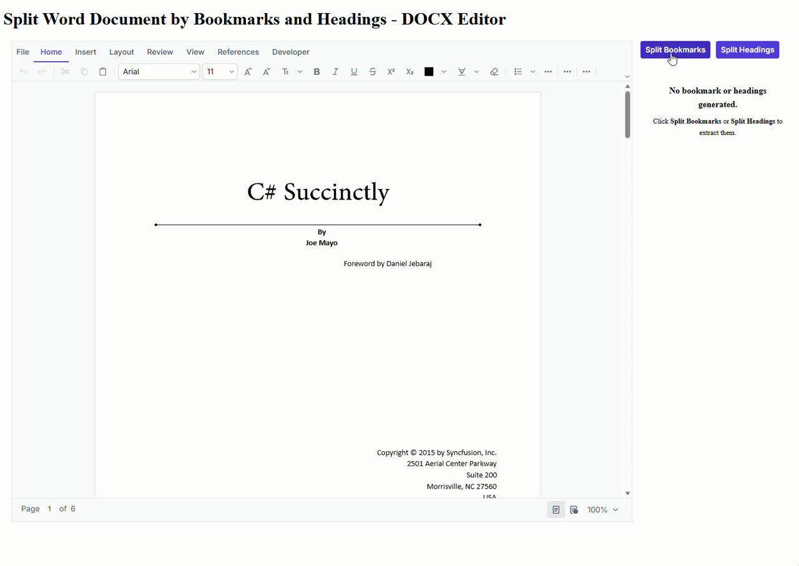

# Split Word Document by Bookmarks and Headings - React DOCX Editor

## Introduction
This sample demonstrates how to split a SFDT or DOCX document into multiple documents based on **Bookmarks** or **Headings** using the Syncfusion<sup style="font-size:70%">&reg;</sup> [React DOCX Editor](https://www.syncfusion.com/docx-editor-sdk/react-docx-editor?utm_source=github&utm_medium=listing&utm_campaign=github-github-documenteditor-examples) (Document Editor).

The application loads a Word document, identifies all bookmarks and headings available in the document, extracts the corresponding content for each bookmark or heading, and generates a separate document for every extracted section. The generated documents are displayed in a categorized list, allowing users to preview, print, and download each extracted document individually.

This sample is useful for scenarios such as:

- Splitting a Word document into separate documents based on bookmarks.
- Splitting a Word document into separate documents based on headings.
---
## Features

- Load a SFDT or DOCX document into the Syncfusion React DOCX Editor.
- Split the document based on **Bookmarks**.
- Split the document based on **Headings**.
- Retrieve all bookmarks and heading hierarchy from the document.
- Generate an independent document for each extracted bookmark or heading section.
- Display extracted documents in a categorized list.
- Preview extracted documents in a read-only Document Editor.
- Download extracted documents in multiple formats:
  - DOCX
  - SFDT
  - DOTX
  - TXT
- Print extracted documents directly from the preview dialog.

---

## Prerequisites

Ensure the following software is installed before running the sample.

### Software

- Node.js (v18 or later recommended)
- npm

---

## How to Run the Sample

### 1. Clone the repository

```bash
git clone <repository-url>
```

### 2. Navigate to the project folder

```bash
cd <project-folder>
```

### 3. Install dependencies

```bash
npm install
```

### 4. Start the application

```bash
npm start
```

### 5. Open the application

Open your browser and navigate to:

```
http://localhost:3000
```

The sample automatically loads a Word document into the Syncfusion React DOCX Editor.

Choose one of the available split operations:

- **Split Bookmarks** – Extracts the content enclosed within each bookmark and generates a separate document for every bookmark.
- **Split Headings** – Extracts document sections based on headings and generates a separate document for each heading.

---

## How It Works

The sample performs the following steps:

1. Loads a Microsoft Word document into the Syncfusion React DOCX Editor.

2. The user selects one of the available split operations:
   - **Split Bookmarks**
   - **Split Headings**

3. Based on the selected operation:
   - **Split Bookmarks** retrieves all bookmarks from the document.
   - **Split Headings** retrieves all document headings along with their hierarchical structure.

4. The application iterates through each bookmark or heading and extracts the corresponding document content as an independent SFDT document.

5. Each extracted document is stored in memory together with its associated bookmark or heading name.

6. The generated documents are displayed in a categorized list for easy navigation.

7. Selecting an item from the list opens the corresponding document in a read-only Syncfusion Document Editor for preview.

8. Users can then:
   - Preview the extracted document
   - Print the document
   - Download the document in one of the supported formats:
     - DOCX
     - SFDT
     - DOTX
     - TXT

---

## Demo
<p align="center">
  
</p>
---

## Project Workflow

```text
                    Load Word Document (SFDT or DOCX)
                            │
                            ▼
          Open in Syncfusion Document Editor
                            │
                            ▼
             User Chooses Split Operation
                 ┌───────────────────────┐
                 │                       │
                 ▼                       ▼
        Split by Bookmarks      Split by Headings
                 │                       │
                 ▼                       ▼
    Retrieve All Bookmarks    Retrieve All Headings
                 │                       │
                 ▼                       ▼
       Iterate Through Items (Bookmark/Heading)
                            │
                            ▼
           Extract Section as SFDT Document
                            │
                            ▼
          Store Generated Documents in Memory
                            │
                            ▼
          Display Extracted Document List
                            │
                            ▼
              User Selects a Document
                            │
                            ▼
      Preview in Read-only Document Editor
                            │
                ┌───────────┴───────────┐
                ▼                       ▼
         Print Document         Download Document
                          (DOCX / SFDT / DOTX / TXT)
```

# Resources

- **Product page:**   [Syncfusion® React DOCX Editor](https://www.syncfusion.com/docx-editor-sdk/react-docx-editor?utm_source=github&utm_medium=listing&utm_campaign=github-github-documenteditor-examples) 

- **Documentation:**   [Syncfusion® React DOCX Editor - Documentation](https://help.syncfusion.com/document-processing/word/word-processor/react/overview?utm_source=github&utm_medium=listing&utm_campaign=github-github-documenteditor-examples) 

- **Online demo:**   [Syncfusion® React DOCX Editor - Online demo](https://document.syncfusion.com/demos/docx-editor/react/#/tailwind3/document-editor/default?utm_source=github&utm_medium=listing&utm_campaign=github-github-documenteditor-examples) 

# Support and feedback 

For any other queries, reach our [Syncfusion® support team](https://support.syncfusion.com/?utm_source=github&utm_medium=listing&utm_campaign=github-github-documenteditor-examples) or post the queries through the [community forums](https://www.syncfusion.com/forums?utm_source=github&utm_medium=listing&utm_campaign=github-github-documenteditor-examples). 

Request new feature through [Syncfusion® feedback portal](https://www.syncfusion.com/feedback?utm_source=github&utm_medium=listing&utm_campaign=github-github-documenteditor-examples). 

# License

This is a commercial product and requires a paid license for possession or use Syncfusion's licensed software, including this component, is subject to the terms and conditions of [Syncfusion's EULA](https://www.syncfusion.com/license/studio/syncfusion_essential_studio_eula.pdf?utm_source=github&utm_medium=listing&utm_campaign=github-github-documenteditor-examples). You can purchase a licnense [here](https://www.syncfusion.com/sales/products?utm_source=github&utm_medium=listing&utm_campaign=github-github-documenteditor-examples) or start a free 30\-day trial [here](https://www.syncfusion.com/account/manage-trials/start-trials?utm_source=github&utm_medium=listing&utm_campaign=github-github-documenteditor-examples). 